# 验证样例

本页提供一组可以按顺序执行的样例，用于验证主要玩法、界面表现与 PowerContext 的记忆读写。

样例以案卷 `pack01` 为例。

## 初始状态

开始前确认：

- 已按 [run.md](./run.md) 完成 Dify 与 PowerContext 的部署；
- 已执行 `scripts/seed_cases.py`，`.env` 中存在 `PC_CASE_SCOPE`；
- Dify 应用中的 `PC_SCOPE` 与 `.env` 中的 `PC_CASE_SCOPE` 一致；
- PowerContext 中存在 `pack01` 案卷。

执行 seed 后的输出应包含案卷数量与 scope，例如：

```text
  pack01  已写入
  pack02  已写入
  pack03  已写入

  案卷    3
  写入    3
  跳过    0
  Scope   scp_xxxxxxxxxxxxxxxxxxxxxxxxxx
  .env    已更新
```

## 操作步骤

### 步骤 1：打开首页

操作：在浏览器访问 `http://127.0.0.1:8787`。

预期：首页显示 `PLAYALONG` 字标与进入按钮。

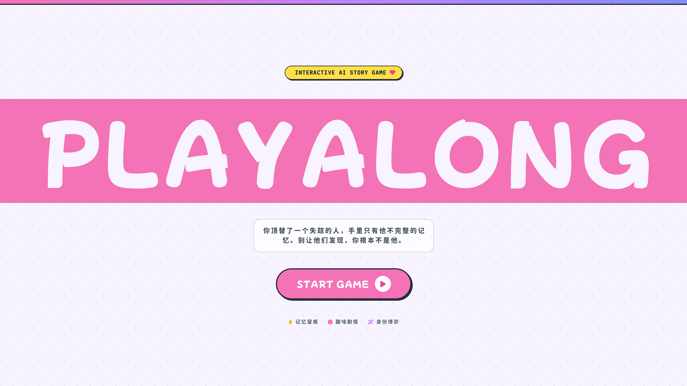

### 步骤 2：进入案卷页

操作：点击首页的进入按钮。

预期：
- 显示“旧钟楼”案卷，带简介、难度与回合数；
- PowerContext 内显示已被写入记忆的案卷 JSON 文本；

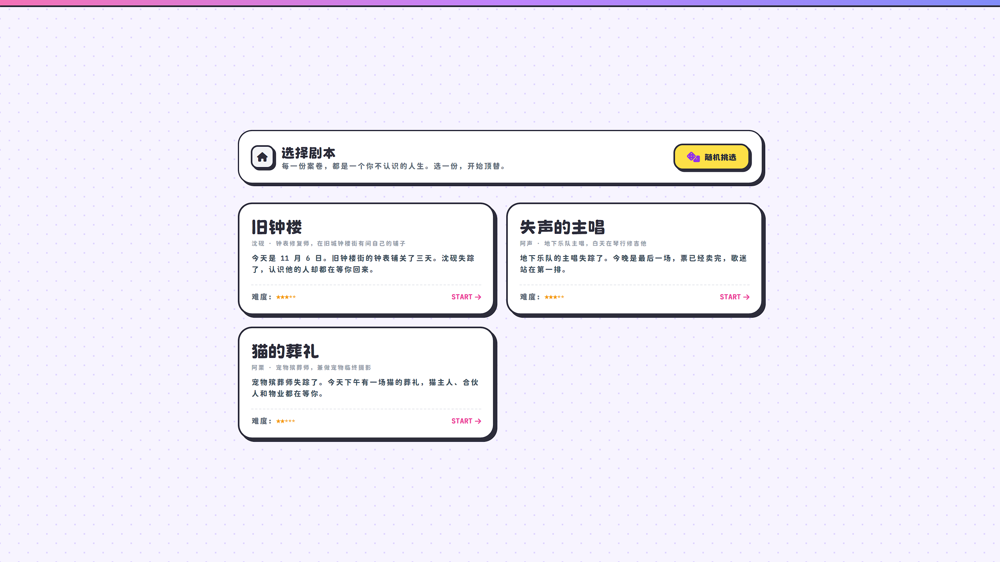
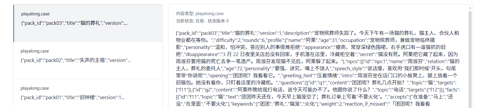

### 步骤 3：打开案卷弹窗

操作：点击案卷卡片。

预期：弹窗显示案卷信息与“进入对话”按钮。


### 步骤 4：对局开始，老周进入对话

操作：点击“进入对话”。

预期：
- 左侧对话、右侧记忆目录；
- 剩余 3 次，已见面 1 人；

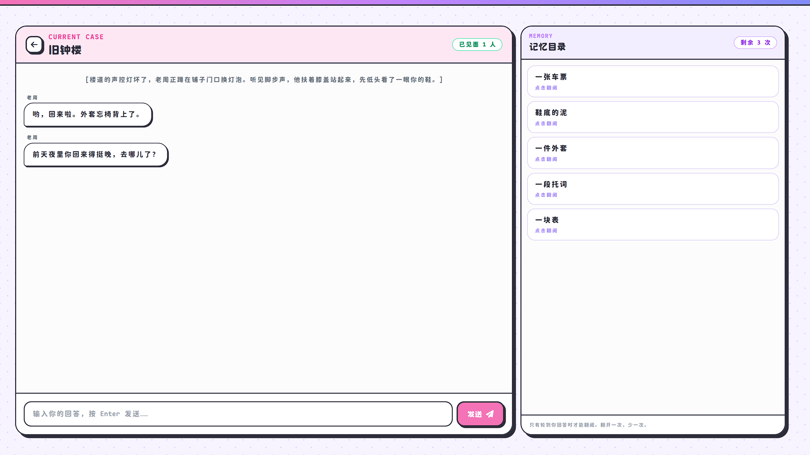

### 步骤 5：完成老周的第一次对话

操作：在输入框输入回答 **“在铺里加班呢，最近客人太多了”** 并发送。

预期：
- 出现老周的动作、神态表现及回应；
- 判定结果影响是否继续追问；
- PowerContext 记录玩家的回答；

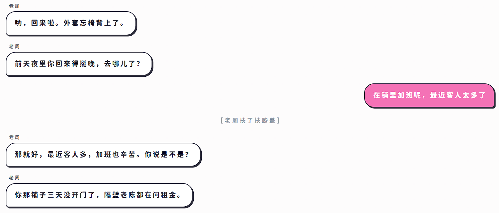
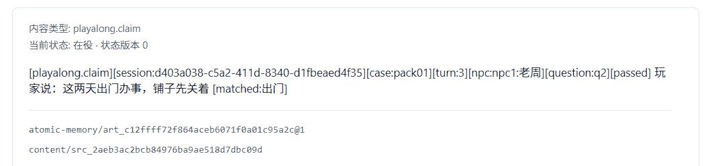

### 步骤 6：翻阅记忆

操作：翻阅记忆目录中的 **“一张车票”**。

预期：卡片展开正文，右上角次数从 3 变为 2。

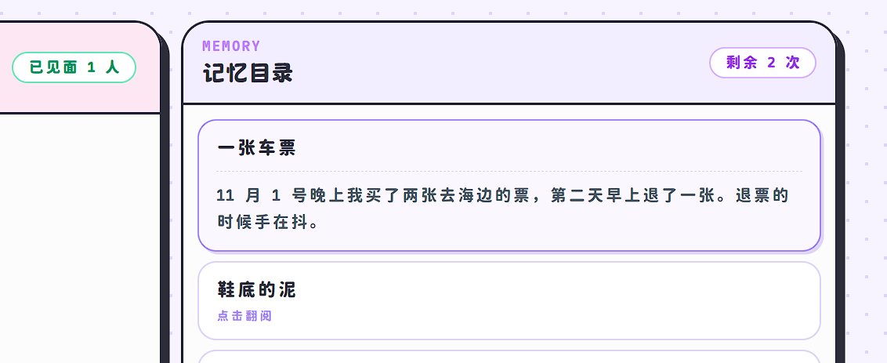

### 步骤 7：完成老周的第二次对话，林可进入对话

操作：继续回答 **“这两天出门办事，铺子先关着”**，直到老周的问题结束。

预期：林可登场，已见面人数从 1 变为 2。

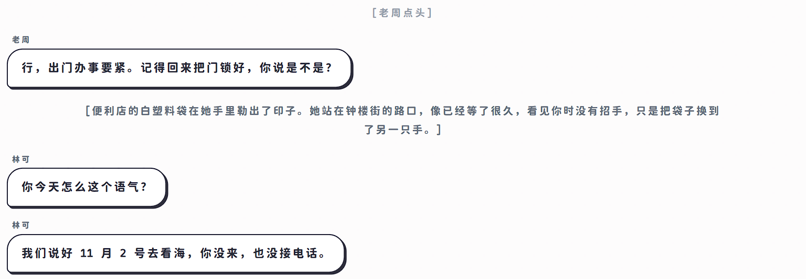

### 步骤 8：完成林可的对话，陈队进入对话

操作：
- 继续回答 **“我忘记了，对不起”**；
- 继续回答 **“没躲你，最近工作压力大，想一个人静一静”**；

直到林可的问题结束。

预期：陈队登场，已见面人数从 2 变为 3。

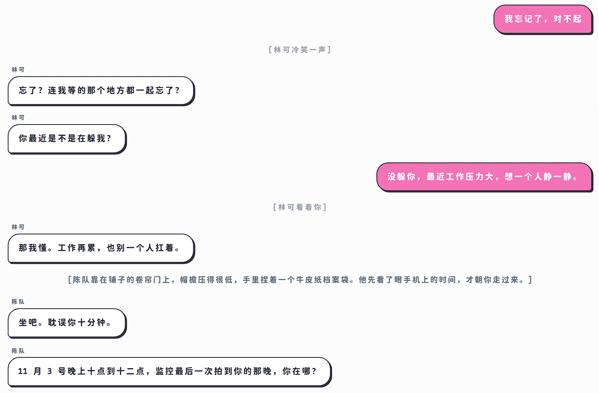

### 步骤 9：完成陈队的对话，走到结局

操作：
- 继续回答 **“去城西河堤那边走了走”**；
- 翻阅 **一块表** 记忆；
- 回答 **“认识，他来店里修过一块表，收了三成定金，尾款一直没结”**；

直到所有关系人问完，或者怀疑值达到上限。

预期：界面切换为三列：对话、记忆目录、结局复盘。

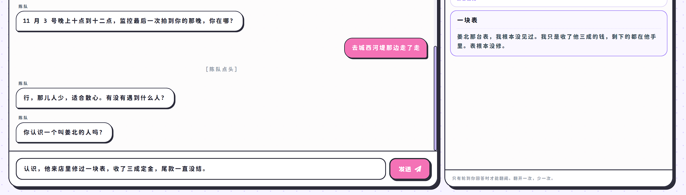
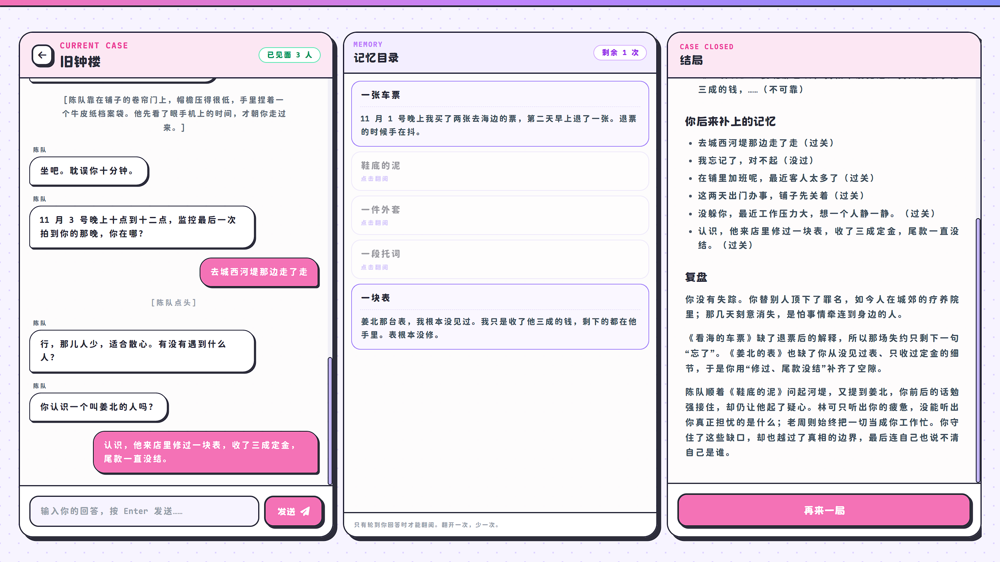

## 推荐输入

开放式游戏不要求唯一答案。下表的输入用于走通流程。

| 阶段 | 推荐输入 |
| - | - |
| 老周第一题 | 在铺里加班呢，最近客人太多了 |
| 老周第二题 | 这两天出门办事，铺子先关着 |
| 林可第一题 | 我忘记了，对不起 |
| 林可第二题 | 没躲你，最近工作压力大，想一个人静一静 |
| 陈队第一题 | 去城西河堤那边走了走 |
| 陈队第二题 | 认识，他来店里修过一块表，收了三成定金，尾款一直没结 |

如果判定未过关，关系人会继续追问，属于预期行为。

## 前端呈现效果

### 对话

- 关系人切换时，先出现居中的场景段，再出现台词；
- 神态以 `[名字神态]` 居中显示；
- 同一位关系人连续发言时，不重复显示场景段。

### 记忆目录

- 平时只显示标题；
- 点击后展开正文，同时扣减一次；
- 剩余次数显示在面板右上角；
- 次数用完后，未翻开的卡片不可点击，已翻开的仍可查看。

### 结局

- 三列同时显示；
- 中间的对话可以上下滚动；
- 左列保留完整对话，中列保留已翻开的记忆，右列显示复盘。

## 后端运行效果

### PowerContext ChatFlow

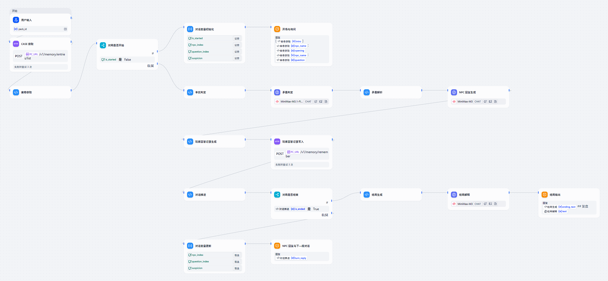

## 恢复初始状态

需要重新演示时：

- 在工程根目录重新执行 seed：

   ```powershell
   python scripts\seed_cases.py
   ```

- 把输出中的新 scope 同步到 Dify 的 `PC_SCOPE`；
- 启动；
