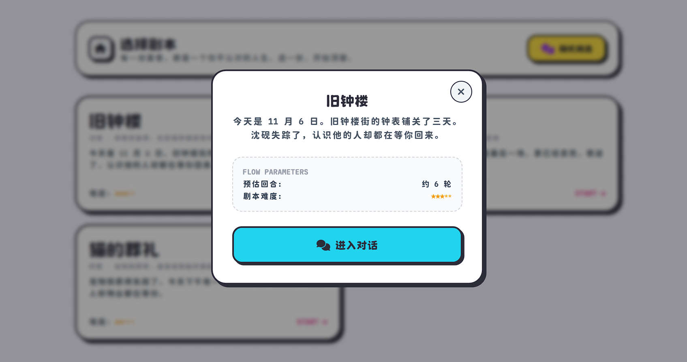

# 验证样例

本页提供一组可以按顺序执行的样例，用于验证主要玩法、界面表现与 PowerContext 的读写。

样例以案卷 `pack01` 为例。

## 初始状态

开始前确认：

- 已按 [run.md](./run.md) 完成 Dify 与 PowerContext 的部署；
- 已执行 `scripts/seed_cases.py`，`.env` 中存在 `PC_CASE_SCOPE`；
- Dify 应用中的 `PC_SCOPE` 与 `.env` 中的 `PC_CASE_SCOPE` 一致；
- PowerContext 中存在 `pack01` 案卷。

执行 seed 后的输出应包含案卷数量与 scope，例如：

```text
pack01  通过
写入    1
Scope   scp_xxxxxxxxxxxxxxxx
```


## 操作步骤

### 步骤 1：打开首页

操作：在浏览器访问 `http://127.0.0.1:8787`。

预期表现：首页显示 `PLAYALONG` 字标与进入按钮。


### 步骤 2：进入案卷页

操作：点击首页的进入按钮。

预期表现：显示“旧钟楼”案卷，带简介、难度与回合数。


### 步骤 3：打开案卷弹窗

操作：点击案卷卡片。

预期表现：弹窗显示案卷信息与“进入对话”按钮。



### 步骤 4：进入对话

操作：点击“进入对话”。

预期表现：左侧对话、右侧记忆目录；剩余 3 次，已见面 0 人。


### 步骤 5：观察开场

操作：等待开场内容出现。

预期表现：先出现居中的场景段，再出现老周台词与第一个问题。


### 步骤 6：老周进入对话、回答他的问题

操作：在输入框输入回答并发送。

预期表现：出现老周的动作、神态表现及回应；判定结果影响是否继续追问。


### 步骤 7：翻阅记忆

操作：点击记忆目录中的“一张车票”。

预期表现：卡片展开正文，右上角次数从 3 变为 2。


### 步骤 8：林可进入对话

操作：继续回答，直到老周的问题结束。

预期表现：林可登场，已见面人数从 1 变为 2。


### 步骤 9：陈队进入对话

操作：继续回答，直到林可的问题结束。

预期表现：陈队登场，已见面人数从 2 变为 3。


### 步骤 10：走到结局

操作：继续回答，直到所有关系人问完，或者怀疑值达到上限。

预期表现：界面切换为三列：对话、记忆目录、结局复盘。


## 推荐输入

开放式游戏不要求唯一答案。下表的输入用于走通流程，不保证全部过关。

| 阶段 | 推荐输入 |
| - | - |
| 老周第一题 | 出去办了点事，回来晚了 |
| 老周第二题 | 这两天出门办事，铺子先关着 |
| 林可第一题 | 我忘记了，对不起 |
| 陈队第一题 | 去城西河堤那边走了走 |

如果判定未过关，关系人会继续追问，属于预期行为。

## 预期表现

### 对话

- 关系人切换时，先出现居中的场景段，再出现台词；
- 神态以 `[名字神态]` 居中显示；
- 同一位关系人连续发言时，不重复显示场景段。

### 记忆目录

- 平时只显示标题；
- 点击后展开正文，同时扣减一次；
- 剩余次数显示在面板右上角；
- 次数用完后，未翻开的卡片不可点击，已翻开的仍可查看。

### 结局

- 三列同时显示；
- 中间的对话可以上下滚动；
- 左列保留完整对话，中列保留已翻开的记忆，右列显示复盘。

## 运行证据

### 界面截图

| 编号 | 文件 | 内容 |
| - | - | - |
| 01 | `images/01-home.png` | 首页与字标 |
| 02 | `images/02-cases.png` | 案卷列表 |
| 03 | `images/03-modal.png` | 案卷弹窗 |
| 04 | `images/04-chat.png` | 对话页两列布局与两个计数 |
| 05 | `images/05-memory.png` | 翻开记忆后的卡片 |
| 06 | `images/06-ending.png` | 结局三列 |
| 07 | `images/07-seed.png` | seed 输出 |
| 08 | `images/08-pc-entries.png` | PowerContext 条目查询结果 |

### PowerContext 记录

查询当前 scope 下的全部条目：

```bash
curl -s http://127.0.0.1:17429/v1/memory/entries/list \
  -H "Authorization: Bearer $PC_TOKEN" \
  -H "Content-Type: application/json" \
  -d '{"scope_id":"<PC_CASE_SCOPE>"}'
```

返回结果中应能区分两类记录：

```text
kind = playalong.case    案卷
kind = playalong.claim   每一轮玩家的回答
```

`playalong.case` 证明案卷由 PowerContext 保存；`playalong.claim` 证明对话内容会写回 PowerContext，并在后续回合被读取。


### Dify 节点记录

在 Dify 的“运行记录”中查看一次完整对话，应能看到：

- HTTP 节点读取 PowerContext 的案卷与历史；
- 矛盾判定节点输出 `has_conflict` 与 `conflict_note`；
- NPC 回复节点引用 `claims_text`；
- 写入节点产生 `playalong.claim`。

## 恢复初始状态

需要重新演示时：

1. 在工程根目录重新执行 seed：

   ```powershell
   python scripts\seed_cases.py
   ```

2. 把输出中的新 scope 同步到 Dify 的 `PC_SCOPE`；
3. 在 Dify 中新建对话。

如果保留原 scope，也可以只新建 Dify 对话。claim 按会话隔离，不会读到上一局的内容。

## 通过标准

- 能完成一次从选择案卷到结局的完整流程；
- 关系人按顺序出现，已见面人数随之增加；
- 记忆可以逐条翻开，次数正确扣减；
- 结局显示三列，对话可滚动；
- PowerContext 中存在对应的 `playalong.case` 与 `playalong.claim` 记录。
